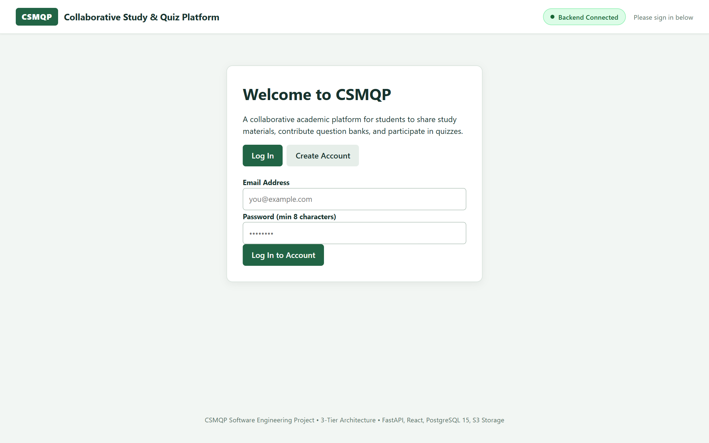
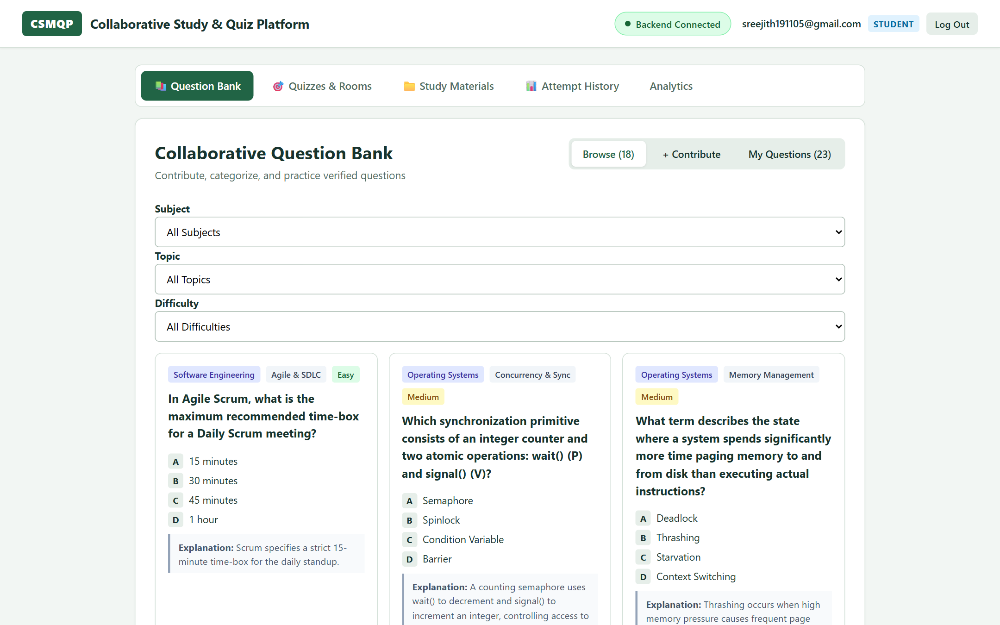
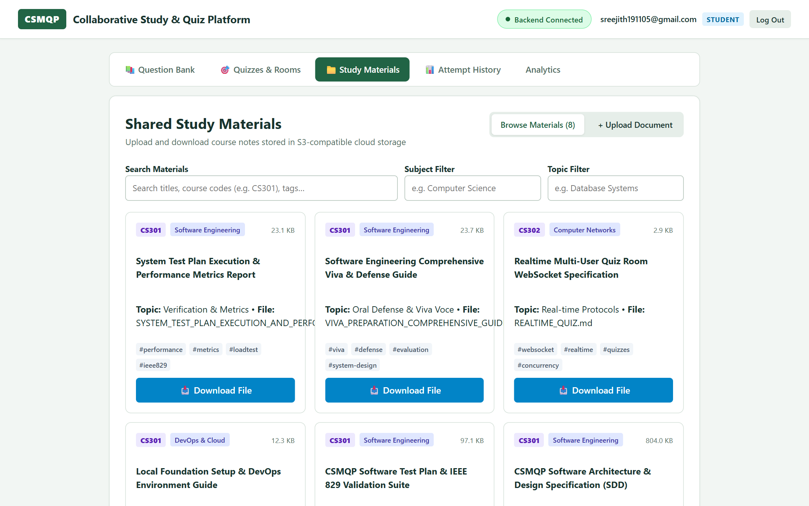
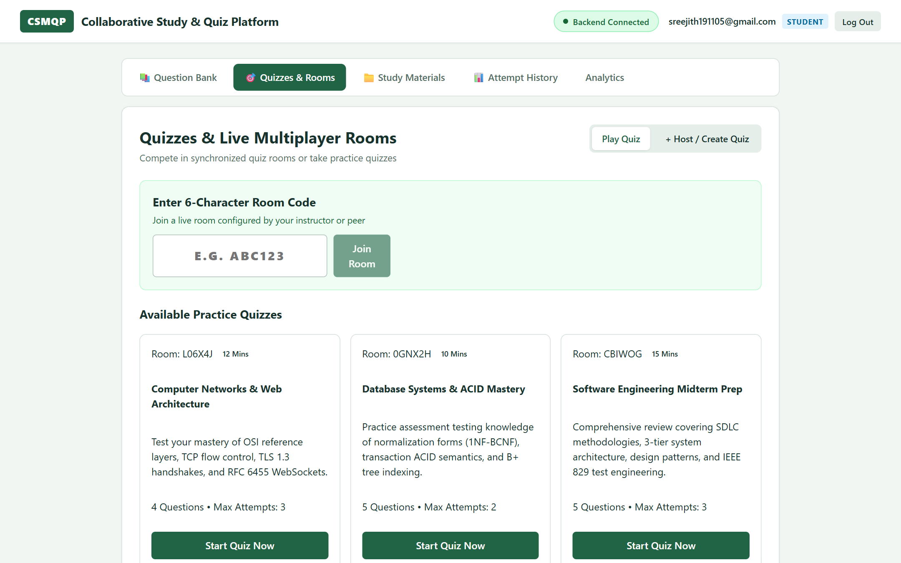
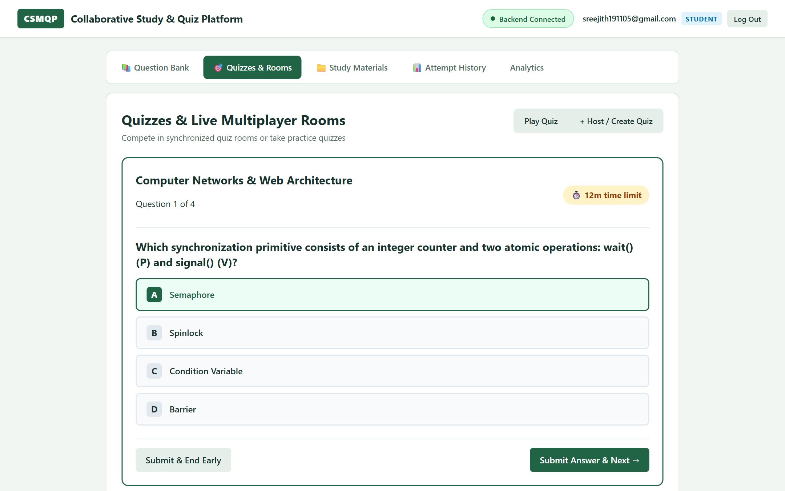
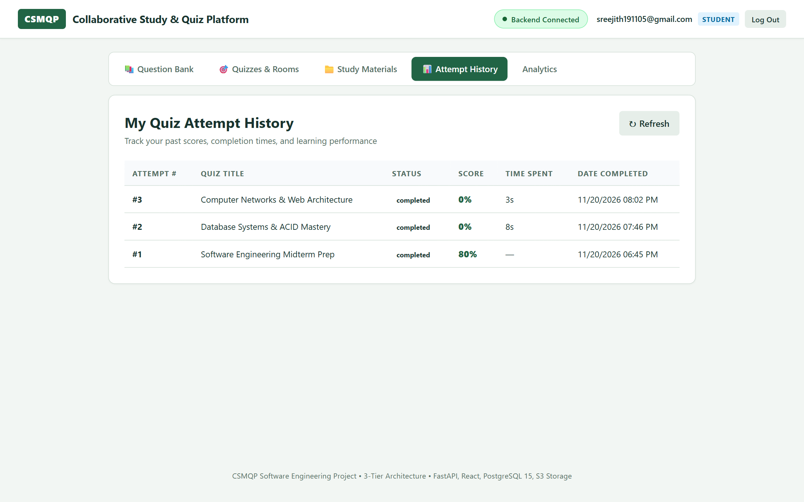
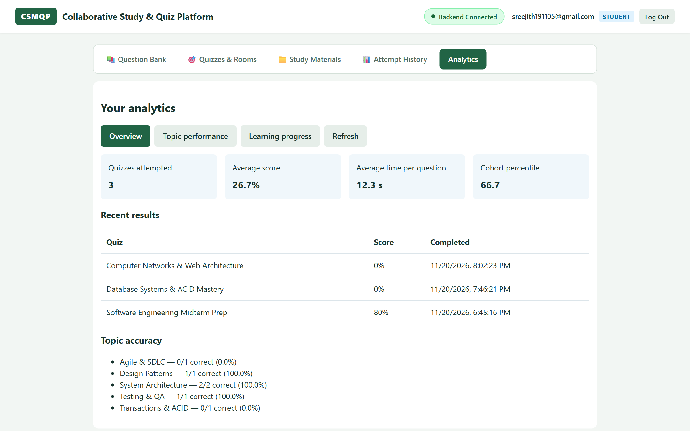
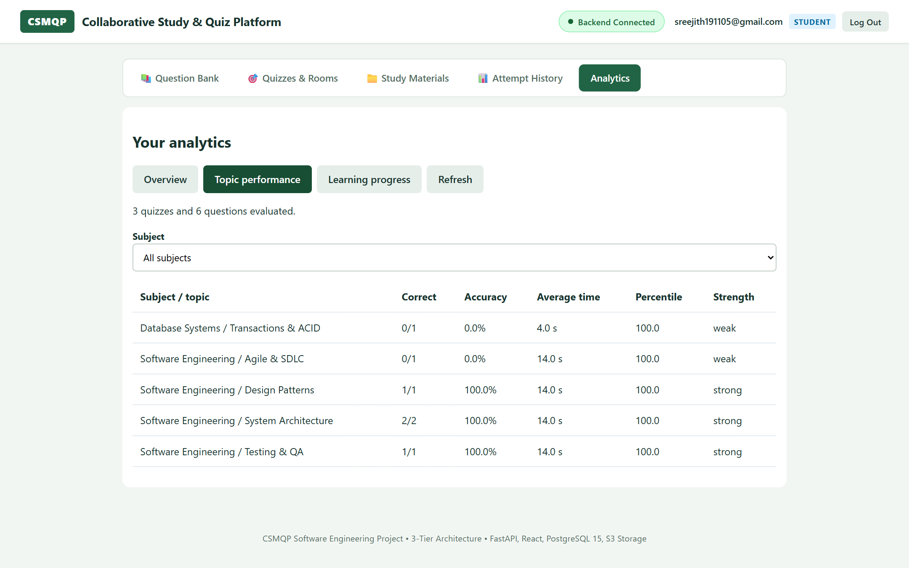
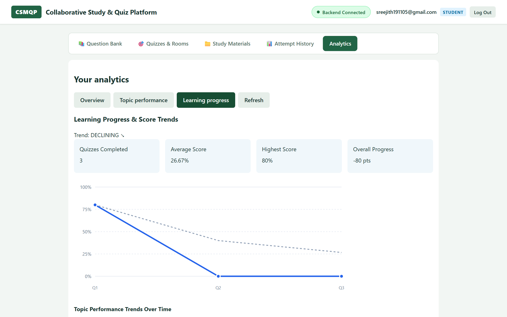
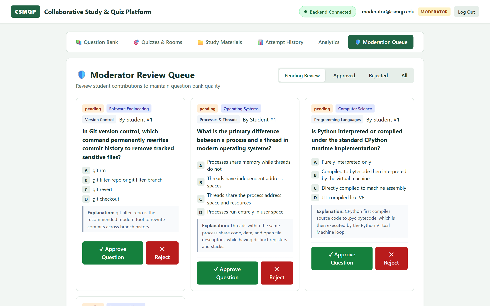

# Collaborative Study Material & Quiz Platform (CSMQP)

A modern, full-stack collaborative academic platform for students and educators to share study materials, contribute multiple-choice question banks, participate in live synchronized and self-paced quizzes, and visualize individual learning progress.

---

## 📸 Platform Overview & Screenshots

### 1. Authentication & Role-Based Access
Secure student registration, Bcrypt password hashing, and 60-minute signed JWT authentication with Student and Moderator roles.



---

### 2. Collaborative Question Bank
Community-driven repository supporting question creation with customizable options, subject/topic categorization, difficulty tagging (Easy, Medium, Hard), and real-time multi-facet filtering.



---

### 3. Study Materials Repository (S3 Storage)
Centralized course document sharing with metadata tagging (course codes, subjects, topics) backed by S3-compatible persistent object storage (RustFS), supporting direct download and review.



---

### 4. Quizzes & Live Multiplayer Rooms
Synchronized live quiz rooms via WebSockets and self-paced practice assessments with 6-character room code joining, duration limits, and automated grading.



---

### 5. Interactive Quiz Player
Active assessment interface with real-time timers, intuitive choice selection, instant question navigation, and automatic score calculation.



---

### 6. Quiz Attempt History
Persistent log of all completed quiz attempts with scores, question timings, submission timestamps, and performance summaries.



---

### 7. Performance Analytics Overview
Aggregated personal performance dashboard featuring overall quiz attempt counts, average scores, mean answer duration, and high-level subject accuracy distributions.



---

### 8. Topic-Wise Performance Analytics
Detailed diagnostic breakdown by academic subject and topic, tracking accuracy percentages, average answer response times, cohort percentiles, and strength/weakness classifications.



---

### 9. Learning Progress & Trajectory Tracking
Longitudinal learning analytics visualization graphing score trajectories across sequential quiz attempts, moving averages, overall progress deltas, and topic trend curves.



---

### 10. Moderator Queue & Audit Trail
Dedicated workflow for moderators to review, approve, or reject student-submitted questions with feedback comments before inclusion in public sets.



---

## 🚀 Start Here

* **[Windows Setup, Commands & Code Explanations](docs/FOUNDATION_SETUP.md)**
* **[Live Quiz WebSocket Events & Client Connection](docs/REALTIME_QUIZ.md)**
* **[Story #21 Verification & Handoff to CI Story #22](docs/FOUNDATION_HANDOFF.md)**
* **[Requirements Traceability: FRs & Sub-FRs to Stories & Epics (Markdown)](docs/fr-subfr-story-epic-mapping.md)** | **[(PDF Version)](docs/fr-subfr-story-epic-mapping.pdf)**
* **[Updated SRS Specification (v2.0)](docs/update%20srs.pdf)**
* **[Updated SDD Architecture Specification (v2.0)](docs/update%20sdd.pdf)**

---

## 🏗️ Architecture & Technology Stack

* **Frontend:** React 19, TypeScript, Vite, Responsive CSS3
* **Backend:** Python 3.12, FastAPI, SQLAlchemy 2 (async/sync engine), Alembic, Pydantic v2
* **Database:** PostgreSQL 15 with persistent volume storage
* **Object Storage:** S3-compatible RustFS storage with bucket initialization
* **Reverse Proxy & TLS:** Caddy 2 with automated TLS 1.3 gateway and WebSocket proxying
* **Security & Auth:** Bcrypt password hashing, PyJWT bearer token authorization, strict CORS policies

---

## 🌐 Local Addresses & Service Ports

| Service | Address | Purpose |
|---|---|---|
| **Frontend UI (Dev)** | `http://localhost:5173` | React + Vite development server |
| **Backend REST API** | `http://127.0.0.1:8000` | FastAPI application endpoints |
| **API Documentation** | `http://127.0.0.1:8000/docs` | Interactive Swagger UI API explorer |
| **Backend Health** | `http://127.0.0.1:8000/health` | Process availability check |
| **Database Check** | `http://127.0.0.1:8000/health/db` | Real PostgreSQL connectivity verify |
| **Storage Check** | `http://127.0.0.1:8000/health/storage` | S3 bucket readiness check |
| **WebSocket Endpoint** | `ws://127.0.0.1:8000/ws` | Real-time quiz room synchronization |
| **Caddy TLS Proxy** | `https://localhost` | Secure TLS 1.3 reverse proxy entry |

---

## 📁 Repository Structure

```text
backend/app/              FastAPI endpoints, authentication, database models, S3 client
backend/tests/            Automated pytest test suite (API, CORS, DB, Storage, WebSocket)
backend/alembic/          Database migration environment and version revisions
docs/                     SRS, SDD, and test plan specifications
docs/screenshots/         UI visual walkthrough screenshots for platform features
demo-videos/              Demonstration video recordings
frontend/src/             React components (QuestionBank, Quizzes, StudyMaterials, Analytics, Moderation)
docker-compose.yml        Multi-container configuration (PostgreSQL, RustFS, Caddy)
Caddyfile                 TLS 1.3 proxy configuration
.env.example              Template for local environment credentials
```

---

## 👥 Team Workflow

* Sprint 1 and Sprint 2 foundation and feature epics are implemented, tested, and verified with 100% automated test coverage.
* Original SRS, architecture/design specification, and test plan PDFs in `docs/` remain the benchmark requirements.
