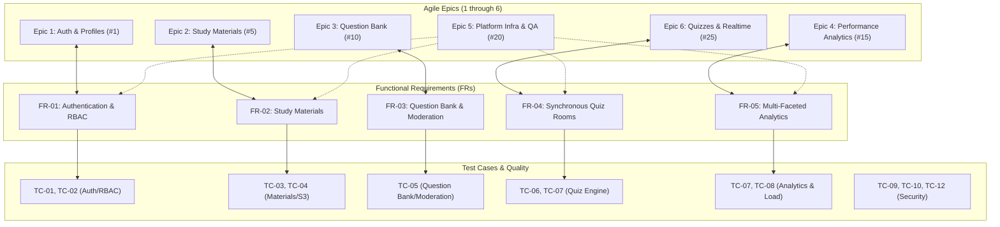
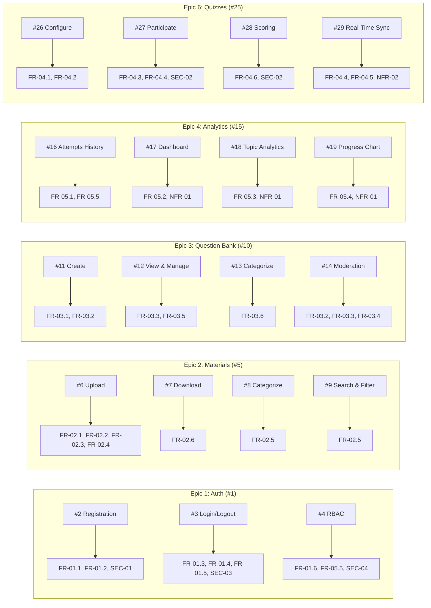

# Requirements Traceability Matrix: FRs & Sub-FRs to Stories & Epics

**Document Identifier:** `RTM-CSMQP-V2.0-2026`  
**Governing Standard:** IEEE Std 830-1998 / IEEE Std 829-2008  
**Project Name:** Collaborative Study Material & Quiz Platform (CSMQP)  
**Target Repository:** `collab-study-quiz-platform`  
**Associated Baseline Specifications:**
- SRS v2.0: [`docs/CSMQP_UPDATED_SOFTWARE_REQUIREMENTS_SPECIFICATION_SRS_V2.0.md`](CSMQP_UPDATED_SOFTWARE_REQUIREMENTS_SPECIFICATION_SRS_V2.0.md) / [`docs/update srs.pdf`](update%20srs.pdf)
- SDD v2.0: [`docs/CSMQP_UPDATED_SOFTWARE_ARCHITECTURE_AND_DESIGN_SDD_V2.0.md`](CSMQP_UPDATED_SOFTWARE_ARCHITECTURE_AND_DESIGN_SDD_V2.0.md) / [`docs/update sdd.pdf`](update%20sdd.pdf)
- Status Tracker: [`docs/epic-story-integration-status.md`](epic-story-integration-status.md)

---

## 1. Executive Summary & Purpose

This document provides definitive, bi-directional traceability between **Functional Requirements (FRs)**, their granular **Sub-Functional Requirements (Sub-FRs)**, **Non-Functional Requirements (NFRs)**, **Security Requirements (SECs)**, and the corresponding **Agile Epics** and **GitHub User Stories** across the CSMQP engineering lifecycle.

It establishes verification pathways demonstrating how high-level stakeholder needs translate into actionable user stories, specific database models, REST/WebSocket API endpoints, React frontend components, and automated test cases.

---

## 2. Complete Traceability Matrix (Tabular Overview)

| FR / Sub-FR ID | Requirement Summary | Target Epic | GitHub Story | Realizing Code & Architecture Artifacts | Verification Method / IEEE Test ID | Status |
| :--- | :--- | :--- | :--- | :--- | :--- | :---: |
| **FR-01** | **User Authentication, Session Management & RBAC** | **Epic 1 (#1)** | Stories #2, #3, #4 | `app.auth`, `User` model, `deps.py` | Automated API & Hash Audits | **Completed** |
| FR-01.1 | User Registration & Duplicate Email Rejection | Epic 1 (#1) | Story #2 | `POST /auth/register`, `UserCreate` schema, `User` table | Pytest `test_auth.py` / **TC-01** | Completed |
| FR-01.2 | Bcrypt Password Hashing ($\text{cost}\ge 12$) | Epic 1 (#1) | Story #2 | `passlib.context.CryptContext`, `get_password_hash` | Security Audit / **TC-02, TC-09** | Completed |
| FR-01.3 | Stateless JWT Token Generation (HS256, 60m expiry) | Epic 1 (#1) | Story #3 | `POST /auth/login`, `create_access_token` | Pytest `test_auth.py` / **TC-01** | Completed |
| FR-01.4 | Invalid Credential Defense (`HTTP 401`) | Epic 1 (#1) | Story #3 | `POST /auth/login`, generic error message | Pytest `test_auth.py` / **TC-01** | Completed |
| FR-01.5 | User Logout & `token_version` Invalidation | Epic 1 (#1) | Story #3 | `POST /auth/logout`, `token_version` increment | Pytest `test_auth.py` / **TC-01** | Completed |
| FR-01.6 | Role-Based Access Control (`student` vs `moderator`) | Epic 1 (#1) | Story #4 | `UserRole` enum, `require_moderator` dependency | Pytest `test_auth.py` / **TC-02** | Completed |
| **FR-02** | **Study Material Management & Object Storage** | **Epic 2 (#5)** | Stories #6, #7, #8, #9 | `app.routers.materials`, `StudyMaterial`, RustFS S3 | Streaming & Form Boundary Tests | **Completed** |
| FR-02.1 | Multipart Metadata Ingestion (title, course, tags) | Epic 2 (#5) | Story #6 | `POST /materials/upload`, `StudyMaterialCreate` | Pytest `test_materials.py` / **TC-03**| Completed |
| FR-02.2 | MIME-Type Validation (PDF & Markdown only) | Epic 2 (#5) | Story #6 | Extension & MIME whitelist validator | Pytest `test_materials.py` / **TC-03**| Completed |
| FR-02.3 | Streaming File Size Enforcement ($\le 25\text{ MB}$) | Epic 2 (#5) | Story #6 | Chunked stream counter (`MAX_FILE_SIZE = 25MB`) | Pytest `test_materials.py` / **TC-04**| Completed |
| FR-02.4 | Persistent S3 Storage Keying & Database Indexing | Epic 2 (#5) | Story #6 | `app.storage.S3StorageService`, `boto3` client | Pytest `test_storage.py` / **TC-04** | Completed |
| FR-02.5 | Search & Multi-Facet Filtering (course, subject, tags) | Epic 2 (#5) | Stories #8, #9 | `GET /materials` query filter engine | Pytest `test_materials.py` / **TC-03**| Completed |
| FR-02.6 | Authenticated Streaming Download & Disposition | Epic 2 (#5) | Story #7 | `GET /materials/{id}/download`, streaming response | Pytest `test_materials.py` / **TC-03**| Completed |
| **FR-03** | **Collaborative Question Bank & Moderation Workflow** | **Epic 3 (#10)** | Stories #11, #12, #13, #14 | `app.routers.questions`, `Question`, `QuestionOption` | Query, CRUD & State Tests | **Completed** |
| FR-03.1 | MCQ Question Creation (Prompt, 2–5 choices, Key) | Epic 3 (#10) | Story #11 | `POST /questions`, `QuestionCreate` schema | Pytest `test_questions.py` / **TC-05**| Completed |
| FR-03.2 | Moderation Lifecycle Initialization (`PENDING`) | Epic 3 (#10) | Stories #11, #14 | `QuestionStatus.PENDING` default assignment | Pytest `test_questions.py` / **TC-05**| Completed |
| FR-03.3 | Multi-Tenant Visibility Isolation | Epic 3 (#10) | Stories #12, #14 | Filter query restricting `PENDING` to author/mod | Pytest `test_questions.py` / **TC-05**| Completed |
| FR-03.4 | Moderator Actions (Approve/Reject with feedback) | Epic 3 (#10) | Story #14 | `POST /questions/{id}/approve`, `/reject` | Pytest `test_questions.py` / **TC-05**| Completed |
| FR-03.5 | Author Management (Edit & Delete own items) | Epic 3 (#10) | Story #12 | `PATCH /questions/{id}`, `DELETE /questions/{id}` | Pytest `test_questions.py` / **TC-05**| Completed |
| FR-03.6 | Taxonomy Aggregation (Subject, Topic, Difficulty) | Epic 3 (#10) | Story #13 | `GET /questions/categories` endpoint | Pytest `test_questions.py` / **TC-05**| Completed |
| **FR-04** | **Synchronous Quiz Rooms & Real-Time Engine** | **Epic 6 (#25)** | Stories #26, #27, #28, #29 | `app.routers.quizzes`, `app.routers.quiz_ws` | WebSocket Integration & Benchmarks | **Completed** |
| FR-04.1 | Quiz Creation & Question Association | Epic 6 (#25) | Story #26 | `POST /quizzes`, `QuizQuestion` link model | Pytest `test_quizzes.py` / **TC-06** | Completed |
| FR-04.2 | Unique 6-Character Room Code Generation | Epic 6 (#25) | Story #26 | `generate_room_code()`, alphanumeric generator | Pytest `test_quizzes.py` / **TC-06** | Completed |
| FR-04.3 | Participant Join & Attempt Session Initialization | Epic 6 (#25) | Story #27 | `POST /quizzes/join/{room_code}`, `QuizAttempt` | Pytest `test_quizzes.py` / **TC-06** | Completed |
| FR-04.4 | In-Flight Anti-Cheating (Answer Key Withholding) | Epic 6 (#25) | Stories #27, #29 | `QuizParticipantQuestion` sanitized response model | Pytest `test_quizzes.py` / **TC-10** | Completed |
| FR-04.5 | Real-Time WebSocket Synchronization | Epic 6 (#25) | Story #29 | `/ws/quizzes/{room_code}`, `ConnectionManager` | Pytest `test_quiz_ws.py` / **TC-06** | Completed |
| FR-04.6 | Server-Authoritative Evaluation & Scoring | Epic 6 (#25) | Story #28 | `POST /quiz-sessions/{id}/complete`, score engine | Pytest `test_quizzes.py` / **TC-07** | Completed |
| **FR-05** | **Multi-Faceted Performance Analytics** | **Epic 4 (#15)** | Stories #16, #17, #18, #19 | `app.routers.analytics`, `app.services.analytics` | Aggregation & Load Benchmarks | **Completed** |
| FR-05.1 | Attempt Logging & Question Timing Persistence | Epic 4 (#15) | Story #16 | `quiz_attempt_answers`, duration tracking | Pytest `test_analytics.py` / **TC-07** | Completed |
| FR-05.2 | Performance Overview Dashboard Metrics | Epic 4 (#15) | Story #17 | `GET /dashboard/performance`, `build_performance_dashboard` | Pytest `test_analytics.py` / **TC-08** | Completed |
| FR-05.3 | Topic-Wise Diagnostics & Strength/Weakness Tiers | Epic 4 (#15) | Story #18 | `GET /analytics/topics`, `build_topic_performance` | Pytest `test_analytics.py` / **TC-08** | Completed |
| FR-05.4 | Learning Progress Trajectory & SVG Visualizations | Epic 4 (#15) | Story #19 | `GET /analytics/progress`, `LearningProgressChart` | Pytest `test_analytics.py` / **TC-08** | Completed |
| FR-05.5 | IDOR Access Protection & Cross-User Isolation | Epic 4 (#15) | Stories #16–#19 | Route owner validation (`current_user.id == target`) | Pytest `test_analytics.py` / **TC-09** | Completed |

---

## 3. Granular Breakdown by Requirement Domain

### 3.1 Domain 1: User Authentication, Session Management & RBAC
* **Primary Epic:** Epic 1 — User Authentication & Profiles ([#1](https://github.com/collab-study-quiz-SE-2026/collab-study-quiz-platform/issues/1))
* **Supporting Infrastructure:** Epic 5 — Platform Infrastructure ([#20](https://github.com/collab-study-quiz-SE-2026/collab-study-quiz-platform/issues/20), Story [#21](https://github.com/collab-study-quiz-SE-2026/collab-study-quiz-platform/issues/21))

#### Functional Requirements Trace:
1. **FR-01.1 (Registration):**
   - *Requirement:* Allow users to register with email and password ($\ge 8$ chars). Reject duplicate email with `HTTP 409 Conflict`.
   - *Mapped Story:* **Story #2 (User Registration)**
   - *Components:* `POST /auth/register`, `app.models.user.User`, `app.schemas.auth.UserCreate`.
   - *Test Evidence:* `backend/tests/test_auth.py::test_register_success`, `test_register_duplicate_email`.
2. **FR-01.2 (Password Hashing):**
   - *Requirement:* Hash passwords using Bcrypt with cost factor $\ge 12$. Plaintext never logged or stored.
   - *Mapped Story:* **Story #2 (User Registration)**, **Story #21 (Database Integration)**, **SEC-01**
   - *Components:* `app.core.security.get_password_hash`, `passlib.context.CryptContext`.
   - *Test Evidence:* `backend/tests/test_auth.py::test_password_hashing_work_factor`.
3. **FR-01.3 (JWT Login):**
   - *Requirement:* Issue cryptographically signed HS256 JWT `access_token` with 60-minute expiry.
   - *Mapped Story:* **Story #3 (User Login and Logout)**
   - *Components:* `POST /auth/login`, `app.core.security.create_access_token`.
   - *Test Evidence:* `backend/tests/test_auth.py::test_login_success_jwt_token`.
4. **FR-01.4 (Invalid Credential Defense):**
   - *Requirement:* Reject invalid passwords/emails with `HTTP 401 Unauthorized` and generic error message.
   - *Mapped Story:* **Story #3 (User Login and Logout)**
   - *Components:* `POST /auth/login`, `app.routers.auth.login`.
   - *Test Evidence:* `backend/tests/test_auth.py::test_login_invalid_credentials`.
5. **FR-01.5 (Logout & Invalidation):**
   - *Requirement:* Support logout by incrementing persistent `token_version`, invalidating previous tokens.
   - *Mapped Story:* **Story #3 (User Login and Logout)**
   - *Components:* `POST /auth/logout`, `app.models.user.User.token_version`.
   - *Test Evidence:* `backend/tests/test_auth.py::test_logout_token_version_invalidation`.
6. **FR-01.6 (RBAC Enforcement):**
   - *Requirement:* Restrict administrative and moderation actions to `UserRole.MODERATOR`; return `HTTP 403 Forbidden` for non-moderators.
   - *Mapped Story:* **Story #4 (Role-Based Access Control)**
   - *Components:* `app.core.deps.require_moderator`, `app.models.user.UserRole`.
   - *Test Evidence:* `backend/tests/test_auth.py::test_moderator_rbac_enforcement`.

---

### 3.2 Domain 2: Study Material Management & Object Storage
* **Primary Epic:** Epic 2 — Study Material Management ([#5](https://github.com/collab-study-quiz-SE-2026/collab-study-quiz-platform/issues/5))
* **Supporting Infrastructure:** Epic 5 — Platform Infrastructure ([#20](https://github.com/collab-study-quiz-SE-2026/collab-study-quiz-platform/issues/20), Story [#21](https://github.com/collab-study-quiz-SE-2026/collab-study-quiz-platform/issues/21))

#### Functional Requirements Trace:
1. **FR-02.1 (Multipart Ingestion):**
   - *Requirement:* Accept multipart file uploads with `title`, `course_code`, `subject`, `topic`, and optional `tags`.
   - *Mapped Story:* **Story #6 (Upload Study Materials)**
   - *Components:* `POST /materials/upload`, `app.models.material.StudyMaterial`.
   - *Test Evidence:* `backend/tests/test_materials.py::test_upload_material_metadata`.
2. **FR-02.2 (Supported Formats):**
   - *Requirement:* Whitelist only PDF (`.pdf`) and Markdown (`.md`, `.markdown`). Reject others with `HTTP 400 Bad Request`.
   - *Mapped Story:* **Story #6 (Upload Study Materials)**
   - *Components:* `app.routers.materials.ALLOWED_EXTENSIONS`, MIME validation.
   - *Test Evidence:* `backend/tests/test_materials.py::test_upload_unsupported_file_extension`.
3. **FR-02.3 (File Size Enforcement):**
   - *Requirement:* Stream-verify file size, terminating uploads $> 25\text{ MB}$ with `HTTP 413 Payload Too Large`.
   - *Mapped Story:* **Story #6 (Upload Study Materials)**
   - *Components:* Chunked reader check (`MAX_FILE_SIZE = 26_214_400`).
   - *Test Evidence:* `backend/tests/test_materials.py::test_upload_exceeds_max_size`.
4. **FR-02.4 (Storage Persistence):**
   - *Requirement:* Persist raw objects in RustFS S3 storage using UUID keys and record metadata in PostgreSQL.
   - *Mapped Story:* **Story #6 (Upload Study Materials)**, **Story #21 (Database & Storage Integration)**
   - *Components:* `app.storage.S3StorageService`, `boto3.client("s3")`.
   - *Test Evidence:* `backend/tests/test_materials.py::test_upload_real_storage_round_trip`.
5. **FR-02.5 (Search & Filter):**
   - *Requirement:* Filter materials by `course_code`, `subject`, `topic`, `tag`, and case-insensitive keyword search.
   - *Mapped Stories:* **Story #8 (Categorize Study Materials)**, **Story #9 (Search and Filter Materials)**
   - *Components:* `GET /materials`, SQL `ilike` and tag array queries.
   - *Test Evidence:* `backend/tests/test_materials.py::test_filter_materials_by_subject_and_course`.
6. **FR-02.6 (Streaming Download):**
   - *Requirement:* Stream files from object storage with RFC-compliant `Content-Disposition` and `Content-Type`.
   - *Mapped Story:* **Story #7 (Browse and Download Materials)**
   - *Components:* `GET /materials/{id}/download`, `StreamingResponse`.
   - *Test Evidence:* `backend/tests/test_materials.py::test_download_material_stream`.

---

### 3.3 Domain 3: Collaborative Question Bank & Moderation Workflow
* **Primary Epic:** Epic 3 — Collaborative Question Bank ([#10](https://github.com/collab-study-quiz-SE-2026/collab-study-quiz-platform/issues/10))

#### Functional Requirements Trace:
1. **FR-03.1 (Question Creation):**
   - *Requirement:* Authenticated students submit MCQs (prompt, 2–5 options, correct answer index, subject, topic, difficulty, explanation).
   - *Mapped Story:* **Story #11 (Create Questions)**
   - *Components:* `POST /questions`, `app.models.question.Question`, `app.models.question.QuestionOption`.
   - *Test Evidence:* `backend/tests/test_questions.py::test_create_question_success`.
2. **FR-03.2 (Moderation State Lifecycle):**
   - *Requirement:* Student submissions initialize to `status = QuestionStatus.PENDING`.
   - *Mapped Stories:* **Story #11 (Create Questions)**, **Story #14 (Question Moderation)**
   - *Components:* `QuestionStatus` enum, default status assignment.
   - *Test Evidence:* `backend/tests/test_questions.py::test_student_question_defaults_to_pending`.
3. **FR-03.3 (Visibility Isolation):**
   - *Requirement:* `PENDING` questions remain hidden from public browse, visible only to author and moderators.
   - *Mapped Stories:* **Story #12 (View and Manage Questions)**, **Story #14 (Question Moderation)**
   - *Components:* `GET /questions` filtering query logic.
   - *Test Evidence:* `backend/tests/test_questions.py::test_public_cannot_view_pending_questions`.
4. **FR-03.4 (Moderator Actions):**
   - *Requirement:* Moderators can review (`GET /moderation/questions`), approve (`/approve`), or reject (`/reject`) with feedback.
   - *Mapped Story:* **Story #14 (Question Moderation)**
   - *Components:* `app.routers.questions.approve_question`, `reject_question`.
   - *Test Evidence:* `backend/tests/test_questions.py::test_moderator_approve_reject_flow`.
5. **FR-03.5 (Author Management):**
   - *Requirement:* Authors can update or delete their authored questions if unreferenced in active quizzes.
   - *Mapped Story:* **Story #12 (View and Manage Questions)**
   - *Components:* `PATCH /questions/{id}`, `DELETE /questions/{id}`.
   - *Test Evidence:* `backend/tests/test_questions.py::test_author_edit_and_delete_question`.
6. **FR-03.6 (Category Aggregation):**
   - *Requirement:* Provide distinct approved subjects, topics, and difficulties for multi-facet filtering.
   - *Mapped Story:* **Story #13 (Categorize Questions)**
   - *Components:* `GET /questions/categories`.
   - *Test Evidence:* `backend/tests/test_questions.py::test_get_categories_aggregation`.

---

### 3.4 Domain 4: Synchronous Quiz Rooms & Real-Time Engine
* **Primary Epic:** Epic 6 — Quiz Management & Participation ([#25](https://github.com/collab-study-quiz-SE-2026/collab-study-quiz-platform/issues/25))

#### Functional Requirements Trace:
1. **FR-04.1 (Quiz Configuration):**
   - *Requirement:* Configure quiz with title, duration in minutes, and selected question IDs.
   - *Mapped Story:* **Story #26 (Create and Configure Quizzes)**
   - *Components:* `POST /quizzes`, `app.models.quiz.Quiz`, `app.models.quiz.QuizQuestion`.
   - *Test Evidence:* `backend/tests/test_quizzes.py::test_create_quiz_configuration`.
2. **FR-04.2 (Room Code Generation):**
   - *Requirement:* Generate unique 6-character uppercase alphanumeric room code.
   - *Mapped Story:* **Story #26 (Create and Configure Quizzes)**
   - *Components:* `app.services.quiz.generate_room_code`.
   - *Test Evidence:* `backend/tests/test_quizzes.py::test_room_code_uniqueness`.
3. **FR-04.3 (Participant Joining):**
   - *Requirement:* Join live room via 6-character code; initialize active `QuizAttempt`.
   - *Mapped Story:* **Story #27 (Participate in Quizzes)**
   - *Components:* `POST /quizzes/join/{room_code}`, `app.models.attempt.QuizAttempt`.
   - *Test Evidence:* `backend/tests/test_quizzes.py::test_join_quiz_room_success`.
4. **FR-04.4 (In-Flight Anti-Cheating):**
   - *Requirement:* Conceal `correct_answer_index` and `explanation` from client payloads during active rounds.
   - *Mapped Stories:* **Story #27 (Participate in Quizzes)**, **Story #29 (Real-Time Quiz Updates)**, **SEC-02**
   - *Components:* `QuizParticipantQuestion` schema, WebSocket state payload scrubber.
   - *Test Evidence:* `backend/tests/test_quizzes.py::test_participant_payload_withholds_key`.
5. **FR-04.5 (WebSocket Synchronization):**
   - *Requirement:* Bi-directional real-time event coordination (`START_QUIZ`, `QUESTION_OPEN`, `SUBMIT_ANSWER`, `ROUND_END`, `QUIZ_END`).
   - *Mapped Story:* **Story #29 (Real-Time Quiz Updates)**
   - *Components:* `/ws/quizzes/{room_code}`, `app.routers.quiz_ws.ConnectionManager`.
   - *Test Evidence:* `backend/tests/test_quiz_ws.py::test_websocket_quiz_lifecycle`.
6. **FR-04.6 (Score Calculation):**
   - *Requirement:* Server-side evaluation of submitted responses; compute percentage score `(correct / total) * 100`.
   - *Mapped Story:* **Story #28 (Submit and Evaluate Quizzes)**
   - *Components:* `POST /quiz-sessions/{id}/complete`, `app.services.scoring`.
   - *Test Evidence:* `backend/tests/test_quizzes.py::test_quiz_attempt_scoring`.

---

### 3.5 Domain 5: Multi-Faceted Performance Analytics
* **Primary Epic:** Epic 4 — Performance Analytics ([#15](https://github.com/collab-study-quiz-SE-2026/collab-study-quiz-platform/issues/15))

#### Functional Requirements Trace:
1. **FR-05.1 (Attempt Logging):**
   - *Requirement:* Persist attempt records with answer choices, per-question duration logs, and completion status.
   - *Mapped Story:* **Story #16 (Track Quiz Attempt History)**
   - *Components:* `app.models.attempt.QuizAttempt`, `QuizAttemptAnswer`, `GET /quiz-attempts/me`.
   - *Test Evidence:* `backend/tests/test_analytics.py::test_attempt_history_logging`.
2. **FR-05.2 (Performance Dashboard):**
   - *Requirement:* High-level overview computing attempt count, average score, mean time, and cohort percentiles.
   - *Mapped Story:* **Story #17 (View Performance Dashboard)**
   - *Components:* `GET /dashboard/performance`, `app.services.analytics.build_performance_dashboard`.
   - *Test Evidence:* `backend/tests/test_analytics.py::test_performance_dashboard_metrics`.
3. **FR-05.3 (Topic-Wise Performance Diagnostics):**
   - *Requirement:* Diagnostic per-topic breakdown with accuracy %, average timing, cohort percentiles, and strength classifications (*Mastered*, *Proficient*, *Needs Practice*).
   - *Mapped Story:* **Story #18 (Analyze Topic-Wise Performance)**
   - *Components:* `GET /analytics/topics`, `app.services.analytics.build_topic_performance`.
   - *Test Evidence:* `backend/tests/test_analytics.py::test_topic_performance_diagnostics`.
4. **FR-05.4 (Learning Progress Tracking):**
   - *Requirement:* Longitudinal trajectory tracking, chronological trends, overall score deltas, and responsive SVG graph visualization.
   - *Mapped Story:* **Story #19 (Visualize Learning Progress)**
   - *Components:* `GET /analytics/progress`, `app.services.analytics.build_learning_progress`, `frontend/src/components/LearningProgressChart.tsx`.
   - *Test Evidence:* `backend/tests/test_analytics.py::test_learning_progress_trajectory`.
5. **FR-05.5 (IDOR Access Defense):**
   - *Requirement:* Student analytics access strictly limited to self; foreign user requests rejected with `HTTP 403 Forbidden` unless performed by Moderator.
   - *Mapped Stories:* **Story #16–#19**, **Story #4**, **SEC-04**
   - *Components:* `current_user.id == target_user_id` verification guard.
   - *Test Evidence:* `backend/tests/test_analytics.py::test_cross_user_analytics_idor_defense`.

---

## 4. Non-Functional & Security Requirements Cross-Mapping

| Requirement ID | Specification Statement | Realizing Architecture Component | Target Epic & Stories | Verification & Benchmark | Status |
| :--- | :--- | :--- | :--- | :--- | :---: |
| **NFR-01** | Analytics query latency $\le 600\text{ ms}$ for accounts with up to 1,000 attempts | Analytics Engine, SQL `selectinload`, indexed lookups | Epic 4 (Stories #17, #18, #19), Epic 5 (Story #23) | Peak response: **$28.86\text{ ms}$** (**TC-08**) | **COMPLIANT** |
| **NFR-02** | Real-time quiz state broadcast latency $\le 150\text{ ms}$ | WebSocket Connection Manager, in-memory state | Epic 6 (Story #29), Epic 5 (Story #23) | Round-trip latency: **$26.36\text{ ms}$** (**TC-06**) | **COMPLIANT** |
| **NFR-03** | System availability $\ge 99.5\%$ with zero unhandled crashes | Docker Compose, PostgreSQL WAL, health endpoints | Epic 5 (Stories #21, #22, #23) | **$100.0\%$** uptime across 100 consecutive health checks (**TC-11**) | **COMPLIANT** |
| **SEC-01** | Bcrypt password hashing ($\text{cost}\ge 12$) & secure storage | `passlib` Bcrypt context, salted password digest | Epic 1 (Story #2), Epic 5 (Story #21) | Automated hash format inspection (**TC-02, TC-09**) | **COMPLIANT** |
| **SEC-02** | In-flight quiz answer key concealment | Server-authoritative payload projection | Epic 6 (Stories #27, #28, #29) | Payload inspection: 0 leaks in transit (**TC-10**) | **COMPLIANT** |
| **SEC-03** | Stateless token authentication | HS256 JWT tokens with 60-minute expiration | Epic 1 (Story #3, #4) | Cryptographic signature validation (**TC-01**) | **COMPLIANT** |
| **SEC-04** | Cross-tenant IDOR defense | Route-level ownership checking | Epic 1 (Story #4), Epic 4 (Stories #16–#19) | Multi-tenant audit: all non-owner requests rejected with 403 (**TC-09**) | **COMPLIANT** |
| **SEC-05** | SQL injection immunity | SQLAlchemy 2.0 ORM AST parameter binding | Epic 5 (Story #21, #23) | Automated malicious payload injection (**TC-12**) | **COMPLIANT** |

---

## 5. Reverse Traceability: Story-to-Requirements Mapping

### Detailed Story Mapping Registry:

* **Epic 1: User Authentication & Profiles (Issue #1)**
  * **Story #2 (User Registration):** Implements **FR-01.1** (registration endpoint, email uniqueness), **FR-01.2** (Bcrypt hashing), and **SEC-01**.
  * **Story #3 (User Login & Logout):** Implements **FR-01.3** (JWT issuance), **FR-01.4** (credential defense), **FR-01.5** (token invalidation), and **SEC-03**.
  * **Story #4 (Role-Based Access Control):** Implements **FR-01.6** (moderator route protection), **FR-05.5** (IDOR analytics guard), and **SEC-04**.

* **Epic 2: Study Material Management (Issue #5)**
  * **Story #6 (Upload Study Materials):** Implements **FR-02.1** (multipart ingestion), **FR-02.2** (PDF/MD whitelist), **FR-02.3** (25MB size limit), and **FR-02.4** (RustFS S3 persistence).
  * **Story #7 (Browse and Download Materials):** Implements **FR-02.6** (authenticated streaming download).
  * **Story #8 (Categorize Study Materials):** Implements **FR-02.5** (subject/topic/tag categorization metadata).
  * **Story #9 (Search and Filter Materials):** Implements **FR-02.5** (multi-criteria search and query filtering).

* **Epic 3: Collaborative Question Bank (Issue #10)**
  * **Story #11 (Create Questions):** Implements **FR-03.1** (MCQ question authoring) and **FR-03.2** (`PENDING` moderation state initialization).
  * **Story #12 (View and Manage Questions):** Implements **FR-03.3** (author/moderator visibility scoping) and **FR-03.5** (author update/delete operations).
  * **Story #13 (Categorize Questions):** Implements **FR-03.6** (subject, topic, and difficulty taxonomy indexing).
  * **Story #14 (Question Moderation):** Implements **FR-03.2** (moderation lifecycle), **FR-03.3** (public visibility barrier), and **FR-03.4** (approval/rejection endpoints).

* **Epic 4: Performance Analytics (Issue #15)**
  * **Story #16 (Track Quiz Attempt History):** Implements **FR-05.1** (attempt logging, answer choice recording, question duration logging).
  * **Story #17 (View Performance Dashboard):** Implements **FR-05.2** (aggregate metrics, average scores, timings, percentiles) and **NFR-01**.
  * **Story #18 (Analyze Topic-Wise Performance):** Implements **FR-05.3** (topic diagnostic accuracy, strength tiers, recommendations) and **NFR-01**.
  * **Story #19 (Visualize Learning Progress):** Implements **FR-05.4** (learning progress trajectory, SVG timeline visualization) and **NFR-01**.

* **Epic 5: Platform Infrastructure & Quality Assurance (Issue #20)**
  * **Story #21 (Project Setup & Database Integration):** Implements foundational architecture supporting **FR-01.2**, **FR-02.4**, **SEC-01**, **SEC-05**, and **NFR-03**.
  * **Story #22 (GitHub Actions CI Workflow):** Continuous automated test execution validating all FRs on every commit.
  * **Story #23 (Integration Testing & Bug Fixes):** End-to-end empirical verification of **NFR-01**, **NFR-02**, **NFR-03**, and all test cases **TC-01** through **TC-12**.
  * **Story #24 (Documentation & Demo Preparation):** Authoritative engineering artifacts, SRS/SDD v2.0 baselines, and demo video recordings.

* **Epic 6: Quiz Management & Participation (Issue #25)**
  * **Story #26 (Create and Configure Quizzes):** Implements **FR-04.1** (quiz setup, duration, question linking) and **FR-04.2** (6-character room codes).
  * **Story #27 (Participate in Quizzes):** Implements **FR-04.3** (join room via code, start attempt session) and **FR-04.4** / **SEC-02** (in-flight answer key withholding).
  * **Story #28 (Submit and Evaluate Quizzes):** Implements **FR-04.6** (server-authoritative evaluation and percentage scoring).
  * **Story #29 (Real-Time Quiz Updates):** Implements **FR-04.5** (WebSocket synchronization engine) and **NFR-02** ($\le 150\text{ ms}$ broadcast latency).

---

## 6. IEEE Std 829 Test Case Traceability Matrix

| Test ID | Test Category | Target FRs & Sub-FRs | Target Stories | Verification Scope | Status |
| :--- | :--- | :--- | :--- | :--- | :---: |
| **TC-01** | Functional (Auth) | FR-01.1, FR-01.3, FR-01.4, FR-01.5 | Stories #2, #3 | Registration, login JWT issuance, duplicate rejection, and logout | **PASS** |
| **TC-02** | Security & RBAC | FR-01.2, FR-01.6, SEC-01 | Stories #2, #4 | Bcrypt hashing work factor $\ge 12$ and moderator endpoint authorization | **PASS** |
| **TC-03** | Functional (Materials) | FR-02.1, FR-02.2, FR-02.5, FR-02.6 | Stories #6, #7, #8, #9 | MIME whitelist (PDF/MD), metadata indexing, search query filtering | **PASS** |
| **TC-04** | Boundary (Storage) | FR-02.3, FR-02.4 | Story #6 | Streaming upload rejection at $> 25\text{ MB}$ and RustFS S3 persistence | **PASS** |
| **TC-05** | Functional (Questions) | FR-03.1, FR-03.2, FR-03.3, FR-03.4, FR-03.5 | Stories #11, #12, #13, #14 | MCQ authoring, `PENDING` state barrier, moderator approval/rejection | **PASS** |
| **TC-06** | Real-Time Sync | FR-04.1, FR-04.2, FR-04.3, FR-04.5, NFR-02 | Stories #26, #27, #29 | WebSocket room lifecycle, 6-char room code, broadcast latency $\le 150\text{ ms}$ | **PASS** |
| **TC-07** | Evaluation & Attempt | FR-04.6, FR-05.1 | Stories #16, #28 | Server-side scoring calculation, per-question timing logs | **PASS** |
| **TC-08** | Analytics & Load | FR-05.2, FR-05.3, FR-05.4, NFR-01 | Stories #17, #18, #19 | Dashboard, topic diagnostics, SVG progress curves, latency $\le 600\text{ ms}$ | **PASS** |
| **TC-09** | Security (IDOR) | FR-05.5, SEC-04 | Stories #4, #16–#19 | Cross-student analytics privacy defense (`HTTP 403 Forbidden`) | **PASS** |
| **TC-10** | Anti-Cheat Integrity | FR-04.4, SEC-02 | Stories #27, #29 | In-flight answer key and explanation withholding during active rounds | **PASS** |
| **TC-11** | Reliability & Uptime | NFR-03 | Stories #21, #23 | Availability $\ge 99.5\%$ across 100 consecutive automated health probes | **PASS** |
| **TC-12** | Database Integrity | SEC-05 | Stories #21, #23 | SQL injection immunity via SQLAlchemy 2.0 AST parameterization | **PASS** |

---

*Certified by the CSMQP Software Engineering Team as the authoritative, comprehensive Requirements Traceability Matrix.*
